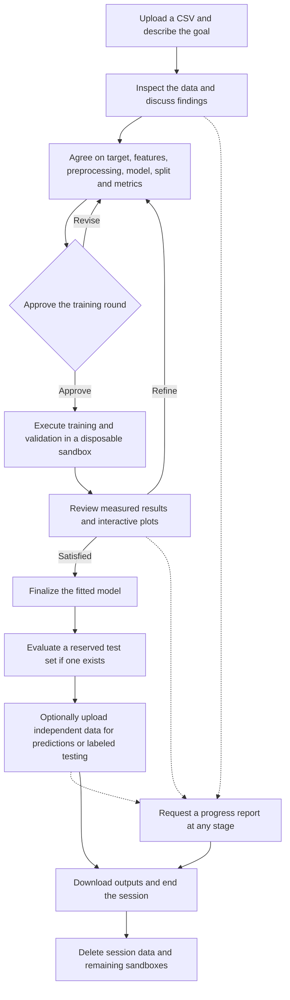
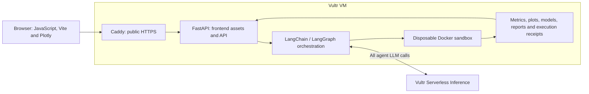

# ML Assistant

**Turning a dataset and a loosely defined goal into a guided machine learning experiment.**

Many people have useful data and a question they want to answer, but no machine learning background. They may want to identify fraudulent transactions, predict customer churn, or flag an operational risk without knowing which column should be the target, which features are useful, or how to evaluate a model.

ML Assistant is a conversational web application built for that starting point. It helps users understand their CSV, translate their goal into a supervised learning problem, agree on an experiment, and interpret results from real model training. The aim is to automate the practical work while helping users understand the decisions being made.

## Technology stack and Vultr deployment

The application combines a lightweight JavaScript frontend with a Python backend and isolated ML execution:

| Layer | Technologies | Responsibility |
| --- | --- | --- |
| Web interface | Vanilla JavaScript, Vite, Plotly.js | CSV uploads, conversation, training-plan approval, interactive results, and downloads |
| Backend API | Python, FastAPI, Pydantic | Request and experiment-plan validation, temporary sessions, artifact delivery, and serving the production frontend |
| Agent orchestration | LangChain, LangGraph | LLM tool calls, conversational workflow, training approvals, and bounded retries |
| Data and machine learning | pandas, NumPy, scikit-learn, XGBoost, LightGBM | Data inspection, preprocessing, classifier training, validation, and prediction |
| Reporting | Matplotlib, markdown-it-py, python-docx | Saved-result plots and Markdown/DOCX progress reports |
| Execution and hosting | Docker, Caddy, systemd | Disposable task containers, public HTTPS routing, and persistent application services |

**Vultr Cloud Compute provides the central application host.** One CPU VM runs the FastAPI backend, serves the built frontend, orchestrates tasks, and launches their Docker sandboxes. Caddy provides the public HTTPS entry point, with the interface and `/api` endpoints sharing the same origin.

**Vultr Serverless Inference powers all agent LLM calls**, including planning, explanations, and report narrative, through its OpenAI-compatible endpoint at `https://api.vultrinference.com/v1`. The inference model is configurable in the backend environment file; its API key stays in the backend and is never passed to the browser or task containers.

**Docker containers on the Vultr VM perform the actual analysis and ML work.** Each task runs separately from the web application process, with network access disabled, resource limits, and container removal afterward. The backend collects computed results and execution evidence for the agent to explain and the user to inspect. Temporary session files support successive tasks and are deleted when the session ends or expires.

For step-by-step VM provisioning, inference configuration, production builds, public HTTPS deployment, and end-to-end verification, see **[SETUP.md](SETUP.md)**. The architecture diagram below shows how these components connect.

## How the ML Assistant helps

The assistant combines conversation with executed analysis. It inspects column types, missing values, duplicate rows, and possible prediction targets, then discusses the findings with the user. It can suggest feature exclusions, preprocessing, an appropriate classifier, a decision threshold, and evaluation metrics suited to the objective.

This matters especially for imbalanced problems such as fraud detection: a high accuracy score can hide a model that misses most fraud. The assistant helps users consider precision, recall, average precision, and the tradeoff between missed events and false alarms.

Users remain involved throughout. Each training round presents a complete plan for approval. After execution, the assistant explains the measured results and returns for feedback and refinement. Routine questions, data inspection, requested predictions, and reports do not introduce repeated approval prompts.

The application produces interactive charts, computed metrics, downloadable execution code, fitted models, and prediction CSVs. A dataset-specific progress report can be requested at any stage in Markdown and DOCX format, including before training. Reports summarize completed work rather than triggering new training or evaluation.

## Workflow

## Supported models and training tools

The current release focuses on relatively fast, CPU-based classifiers for tabular data.

| Model | Training library | Role |
| --- | --- | --- |
| Logistic regression | scikit-learn | An efficient baseline; optional polynomial or interaction-only numeric features |
| Random forest | scikit-learn | An ensemble that can capture nonlinear relationships |
| XGBoost | XGBoost, using its scikit-learn-compatible interface | Gradient-boosted trees for tabular classification |
| LightGBM | LightGBM, using its scikit-learn-compatible interface | Another efficient gradient-boosted tree option |

pandas and NumPy support data preparation. scikit-learn pipelines handle imputation, categorical encoding, scaling where appropriate, splitting, and evaluation. Learned preprocessing is fitted on training data only. Plotly supplies interactive browser charts; Matplotlib produces static report figures.

The assistant can suggest class weighting, stratified/group/chronological splits, configurable validation and test proportions, and threshold choices. An internal test set is optional; independent labeled data can be supplied later. Outputs include precision, recall, specificity, accuracy, balanced accuracy, F1, ROC-AUC, average precision, confusion matrices, ROC and precision–recall curves, and threshold tradeoffs where applicable.

This is conversational automation of a supervised ML workflow. It does not currently run an exhaustive AutoML search or automatically try every model.

## Architecture and Vultr integration

ML Assistant is built for the [Vultr Agent Rush hackathon's Blast Radius Zero challenge](https://lablab.build/ai-hackathons/vultr-hackathon), following its sandboxed code execution pattern.

The Vultr VM hosts the web application, backend orchestration, and task containers. All agent reasoning and report-writing LLM calls use Vultr Serverless Inference. The inference model is configurable; the current default is `qwen3.8-flash-next`.

The agent generates constrained Python calls into a reviewed ML runtime. Training, analysis, prediction, and report execution take place in separate Docker containers, rather than inside the web application process. Containers have no network access or credentials, run as a non-root user, enforce resource limits, and are removed after each task. Execution receipts and downloadable code make the work inspectable.

The frontend and API share one public origin, with backend routes under `/api`. No separate frontend hosting service, managed database, GPU, or Kubernetes cluster is needed for this version.

## Advantages

- **A practical starting point:** users can begin with their data and an approximate goal instead of having to design an ML workflow themselves.
- **Automation with user involvement:** the assistant handles preparation and execution while users approve training decisions and guide refinements.
- **Inspectable results:** metrics and plots come from executed code, with downloadable artifacts and execution evidence.
- **A compact deployment:** the current application runs on one CPU VM with disposable task containers and hosted inference.
- **Room to extend:** separate interface, orchestration, plan validation, and training modules make it easier to add models and problem types as the assistant develops.

## Current scope and limitations

- **Supervised binary classification only.** The training dataset needs an existing target with two classes. Regression, multiclass classification, unsupervised learning, and deep learning are not implemented.
- **Tabular CSV input and a small model set.** The current focus is on simpler, faster CPU models, rather than large-scale training, arbitrary generated programs, or unrestricted automated searches.
- **Bounded data and execution.** Defaults include 25 MiB uploads, up to 100,000 rows and 200 columns, and per-task time and memory limits. High-cardinality categorical features and polynomial expansion have additional bounds. Some datasets will need preparation or smaller samples.
- **Validation remains necessary; an internal test set does not.** Split proportions are configurable before training. Target and split policy remain fixed during an experiment, and finalization freezes the fitted pipeline without a full-data refit. Changing these foundations requires a new session.
- **Results need context.** Small positive-class counts, leakage, distribution shifts, and repeated validation-based refinement can undermine performance estimates. Unlabeled prediction data cannot establish accuracy or other label-dependent metrics. Scores are not presented as calibrated probabilities.
- **Sessions are temporary.** There is no persistent project history or session recovery. Users must download their outputs before ending the session or expiry. Containers are removed after individual tasks; temporary files needed between tasks are retained only for the active session and deleted afterward. Failed cleanup is retried, and abandoned workspaces are removed on startup. This does not imply forensic disk erasure or control over the inference provider's retention policies.

Docker provides process isolation while sharing the VM's kernel. This demo does not claim an absolute sandbox escape guarantee or the operational controls of a mature multi-tenant ML platform.

## Potential extensions

The separation between the web interface, agent workflow, validated experiment plans, and sandbox runtime provides a foundation for adding capabilities without rebuilding the whole application.

Possible future directions include:

- Multiclass and multilabel classification, regression, and richer evaluation strategies.
- Unsupervised learning, clustering, dimensionality reduction, and anomaly detection.
- Deep learning for tabular, text, image, or time-series data.
- Graph-based learning and graph neural networks for connected entities and relationships.
- Cross-validation, bounded hyperparameter search, calibration, explainability, and additional feature engineering.

These are potential extensions, not current features or automatic upgrades. Each would require suitable data validation, training implementations, evaluation logic, dependencies, and execution resources. The longer-term goal is a more complete ML helper that can guide users across a broader range of problems while preserving user involvement and isolated execution.

## Deploy and explore

**[SETUP.md](SETUP.md)** covers deployment on a Vultr VM, Serverless Inference configuration, Docker setup, the production frontend build, public HTTPS access, service management, end-to-end verification, and the recorded containment demonstration.
